<p align="center"><a href="README.md">English</a> · <a href="README.fr.md">Français</a> · <b>Español</b></p>

<p align="center">
  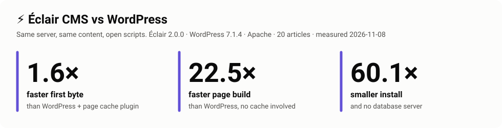
</p>

<p align="center">
  <a href="LICENSE"></a>
  
  
  
  
  
  
</p>

# Benchmarks de Éclair CMS

**Pruebas de rendimiento abiertas y reproducibles de [Éclair CMS](https://github.com/Jacckisback/eclair-cms) frente a WordPress (con y sin caché) y Kirby.** Mismo servidor, mismo PHP, mismo contenido, versiones oficiales, ajustes por defecto. Un solo script instala cada sitio, lo mide desde el servidor y en un navegador real, y dibuja cada gráfico de esta página a partir de los datos brutos.

> **Transparencia total.** Éclair lo desarrolla el autor de este repositorio. Precisamente por eso todo es público: el método, los scripts, el contenido, el JSON bruto de cada medición y los resultados en los que Éclair pierde (también están en este README). No te fíes de estas cifras, [ejecuta la prueba tú mismo](#ejecútalo-tú-mismo). Si encuentras un ajuste que favorece a Éclair, [abre un issue](https://github.com/Jacckisback/eclair-benchmarks/issues): se corregirá y se publicará una nueva medición, aunque el resultado sea peor para Éclair.

Los gráficos están en inglés (una sola versión para los tres idiomas); las cifras aparecen en las tablas.

## Índice

- [Resultados en resumen](#resultados-en-resumen)
- [1. Tiempo de respuesta](#1-tiempo-de-respuesta) · [2. Generar una página sin caché](#2-generar-una-página-sin-caché) · [3. Rendimiento y escalabilidad](#3-rendimiento-y-escalabilidad)
- [4. En un navegador real: Lighthouse](#4-en-un-navegador-real-lighthouse)
- [Qué ocurre dentro de una petición](#qué-ocurre-dentro-de-una-petición)
- [5. Peso de las páginas y tamaño de la instalación](#5-peso-de-las-páginas-y-tamaño-de-la-instalación)
- [6. Nginx, y WordPress detrás de una caché FastCGI de Nginx](#6-nginx-y-wordpress-detrás-de-una-caché-fastcgi-de-nginx)
- [7. Sitios grandes: 1000 y 2900 artículos](#7-sitios-grandes-1000-y-2900-artículos)
- [Qué cambia en la práctica](#qué-cambia-en-la-práctica) · [Cómo se mide](#cómo-se-mide) · [Límites](#límites) · [Ejecútalo tú mismo](#ejecútalo-tú-mismo) · [Hoja de ruta](#hoja-de-ruta)
- Para profundizar (en inglés): [FAQ para profesionales de WordPress](docs/FAQ.md) · [Metodología](docs/METHODOLOGY.md) · [Arquitectura](docs/ARCHITECTURE.md)

## Resultados en resumen

Mediciones del **8 de noviembre de 2026** · Éclair 2.0.0 · WordPress 7.1.4 (tema por defecto Twenty Twenty-Five) · Cache Enabler 1.8.16 · Kirby 5.6.3 (Starterkit, caché de páginas activa) · máquina cloud de 2 vCPU, Ubuntu 24.04, PHP 8.3 FPM con OPcache, MariaDB 10.11

| Medición | Servidor web | Artículos | Informe |
|---|---|---:|---|
| Medición principal | Apache 2.4 | 20 | [results/2026-11-08-apache-20](results/2026-11-08-apache-20/) |
| Medición Nginx (añade WordPress + caché FastCGI de Nginx) | Nginx 1.24 | 20 | [results/2026-11-08-nginx-20](results/2026-11-08-nginx-20/) |
| Sitios grandes | Apache 2.4 | 1000 · 2900 | [results/large-sites](results/large-sites/) |

**Página de artículo, Apache, 20 artículos**

| | Tiempo de respuesta<br><sub>TTFB mediano</sub> | Generada sin caché<br><sub>caché vaciada</sub> | Rendimiento<br><sub>20 conexiones</sub> | Archivos PHP<br><sub>por visita</sub> | LCP Lighthouse<br><sub>móvil, 4G lenta</sub> | Descarga del navegador<br><sub>Lighthouse</sub> |
|---|---:|---:|---:|---:|---:|---:|
| **Éclair 2.0.0** | **1,11 ms** | **3,37 ms** | **1997 req/s** | **1** | **0,95 s** | **10,8 KB** |
| WordPress 7.1.4 + Cache Enabler | 1,80 ms | 75,72 ms | 1060 req/s | 27 | 1,50 s | 97,6 KB |
| WordPress 7.1.4, sin plugin | 75,64 ms | 75,91 ms | 31 req/s | 496 (+32 SQL) | 1,50 s | 97,8 KB |
| Kirby 5.6.3, caché de páginas | 1,89 ms | 3,89 ms | 1106 req/s | 131 | 1,14 s | 23,0 KB |

**En resumen:**

- Frente a **WordPress con un plugin de caché**, Éclair responde **1,6 veces más rápido**, atiende **1,9 veces más visitas** en el mismo servidor y sus páginas hacen descargar al navegador **9 veces menos**.
- Cuando ninguna caché puede ayudar (primera visita tras una edición, páginas que no se pueden cachear), Éclair genera una página **entre 22 y 30 veces más rápido** que WordPress.
- Frente a **Kirby**, el CMS de archivos planos más parecido, Éclair es **entre 1,6 y 1,7 veces más rápido** desde la caché y atiende **1,8 veces más peticiones** por segundo.
- Donde Éclair **no gana**: detrás de una **caché FastCGI de Nginx**, WordPress atiende **1,3 veces más peticiones por segundo** (Nginx responde sin PHP), y en **sitios grandes** la generación de páginas sin caché de Éclair se ralentiza (31 ms con 2900 artículos). Ambos casos se detallan más abajo.

## 1. Tiempo de respuesta

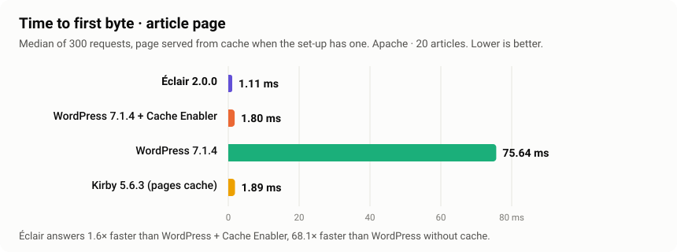

Tiempo hasta el primer byte, mediana de 300 peticiones tras 50 de calentamiento, medido en el servidor (sin red). Es lo que espera un visitante antes de que el navegador pueda empezar a mostrar la página.

| | Página de lista: mediana · p95 | Artículo: mediana · p95 |
|---|---:|---:|
| **Éclair** | **1,15 ms · 1,78 ms** | **1,11 ms · 1,51 ms** |
| WordPress + Cache Enabler | 1,90 ms · 2,23 ms | 1,80 ms · 2,17 ms |
| WordPress | 74,18 ms · 96,12 ms | 75,64 ms · 98,72 ms |
| Kirby (caché de páginas) | 1,83 ms · 2,29 ms | 1,89 ms · 3,05 ms |

## 2. Generar una página sin caché

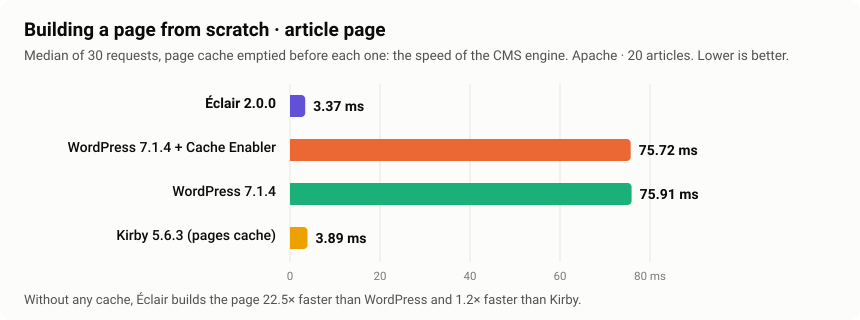

La caché se vacía antes de cada una de las 30 peticiones: es la velocidad del motor del CMS, y lo que reciben los visitantes **en la primera visita tras cada edición** y en las páginas que **no se pueden cachear** (vistas previas, búsqueda, usuarios conectados). Aquí un plugin de caché no puede ayudar a WordPress: Éclair es **22,5 veces más rápido en la página de artículo y 30 veces en la de lista**. Kirby, que también lee archivos planos, está cerca de Éclair con este tamaño de sitio.

## 3. Rendimiento y escalabilidad

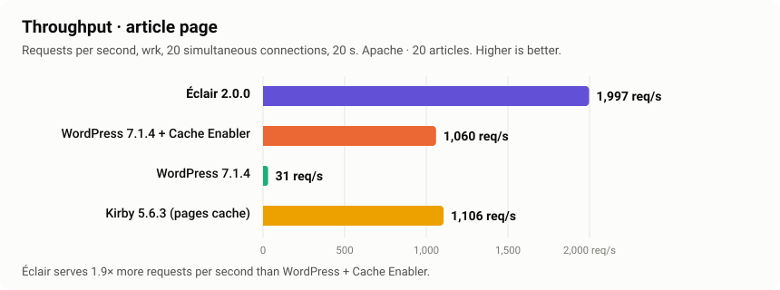

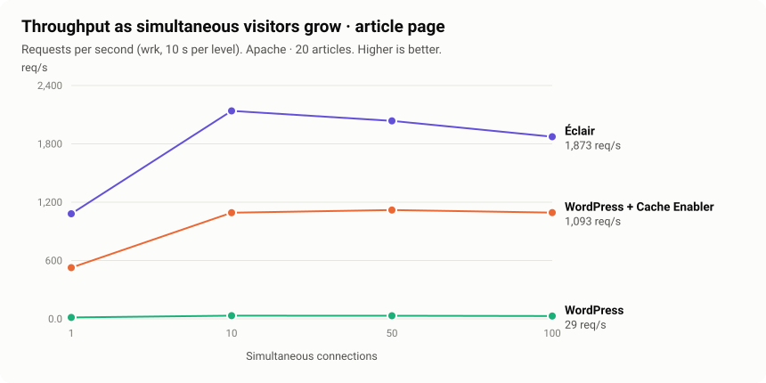

| Página de artículo, Apache | 1 conexión | 10 | 50 | 100 |
|---|---:|---:|---:|---:|
| **Éclair** | 1081 req/s · p99 1,7 ms | 2139 · p99 10,8 ms | 2036 · p99 34,3 ms | 1873 · p99 194,5 ms |
| WordPress + Cache Enabler | 527 · p99 3,0 ms | 1092 · p99 18,1 ms | 1119 · p99 61,7 ms | 1093 · p99 119,7 ms |
| WordPress | 15 · p99 105,8 ms | 33 · p99 400 ms | 32 · p99 1690 ms | 29 · p99 2000 ms |
| Kirby (caché de páginas) | 512 · p99 3,2 ms | 1127 · p99 14,7 ms | 1122 · p99 58,6 ms | 1091 · p99 150,8 ms |

El rendimiento se estanca a partir de 10 conexiones: en esta máquina de 2 vCPU, el procesador, compartido con el generador de carga, es el límite. Éclair mantiene **entre 1,7 y 2 veces el rendimiento** de WordPress + caché y de Kirby en cada nivel.

**Publicado tal cual:** con 100 conexiones en Apache, la latencia p99 de Éclair (195 ms) es más alta que la de WordPress + caché (120 ms). En Nginx ocurre lo contrario (Éclair 48 ms, WordPress + Cache Enabler 89 ms, ver la [sección 6](#6-nginx-y-wordpress-detrás-de-una-caché-fastcgi-de-nginx)): esta cola parece ligada a la cola de espera de Apache delante de PHP-FPM en una máquina pequeña. Pendiente de confirmar con una máquina de carga separada.

## 4. En un navegador real: Lighthouse

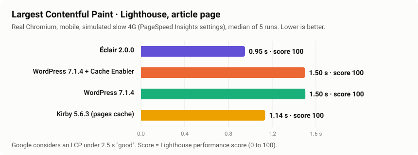

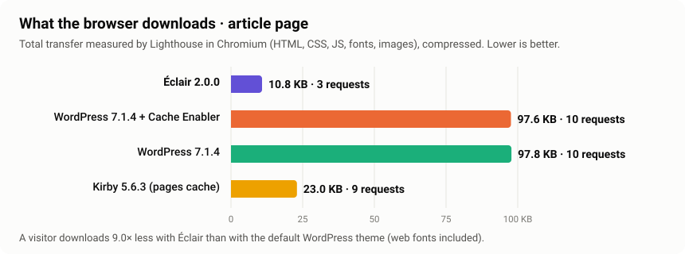

Lighthouse 12.8 en un Chromium real, con los ajustes de PageSpeed Insights (móvil, 4G lenta simulada, CPU 4 veces más lenta), mediana de 5 pasadas.

| Página de artículo | Rendimiento | LCP | FCP | TBT | CLS | Transferencia | Peticiones | Accesibilidad | Buenas prácticas | SEO |
|---|---:|---:|---:|---:|---:|---:|---:|---:|---:|---:|
| **Éclair** | **100** | **0,95 s** | **0,72 s** | 0 ms | 0 | **10,8 KB** | **3** | **100** | **100** | **100** |
| WordPress + Cache Enabler | 100 | 1,50 s | 0,75 s | 18 ms | 0 | 97,6 KB | 10 | 100 | 100 | 92 |
| WordPress | 100 | 1,50 s | 0,75 s | 50 ms | 0 | 97,8 KB | 10 | 100 | 100 | 92 |
| Kirby (caché de páginas) | 100 | 1,14 s | 1,14 s | 0 ms | 0 | 23,0 KB | 9 | 94 | 100 | 90 |

Todas las configuraciones alcanzan la puntuación máxima de rendimiento en estas páginas pequeñas; las métricas de debajo muestran la diferencia. El LCP de Éclair es **0,55 s más corto** que el de WordPress, el navegador descarga **9 veces menos** y Éclair es el único con **100 en SEO** (WordPress 92, Kirby 90). Son mediciones de laboratorio; las Core Web Vitals de campo (incluido INP) necesitan visitantes reales.

## Qué ocurre dentro de una petición

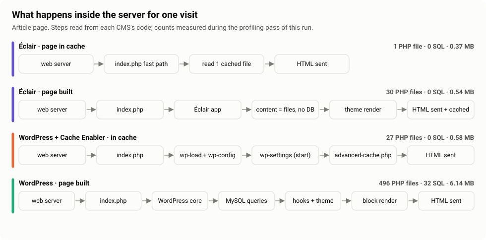

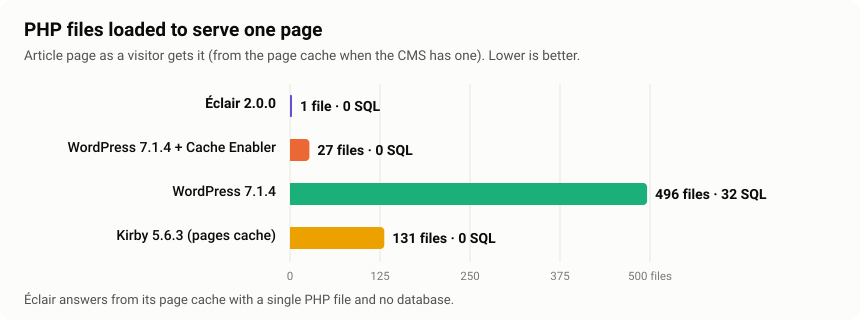

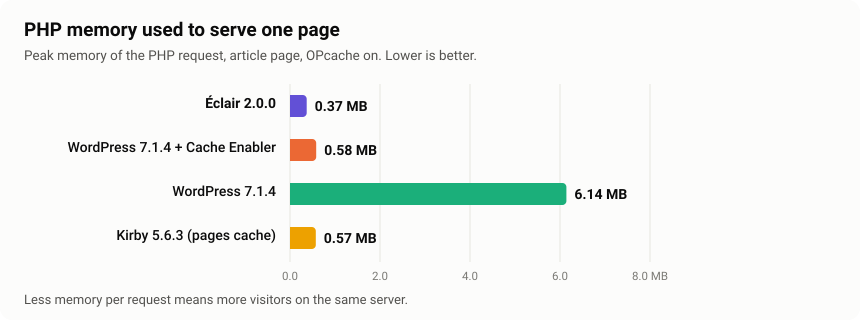

Medido en una pasada de perfilado separada (un `auto_prepend_file` que registra `get_included_files()`, `memory_get_peak_usage()` y `$wpdb->num_queries` al final de la petición), retirada antes de cualquier medición de tiempo.

- **Éclair responde con un solo archivo PHP.** Su `index.php` consulta la caché *antes de que exista la aplicación*: lee unos pocos bytes de ajustes, abre `cache/pages/<md5(ruta)>`, comprueba la generación de la caché, envía las cabeceras guardadas con un `ETag` (y responde `304 Not Modified` cuando puede), transmite el HTML y termina. La invalidación es atómica: cada edición publica una nueva generación de caché *antes* de borrar las páginas antiguas, así que nunca se sirve una página caducada.
- **WordPress + Cache Enabler carga 27 archivos**: `advanced-cache.php` lo carga `wp-settings.php`, después de `wp-load.php` y `wp-config.php`.
- **La caché de páginas de Kirby carga 131 archivos**: la sirve el router de Kirby, después de cargar el núcleo.
- **WordPress sin caché carga ~500 archivos y hace ~30 consultas SQL**: el núcleo, las opciones cargadas automáticamente, la consulta principal, la jerarquía de plantillas y el tema de bloques.

Explicación detallada con referencias al código: [docs/ARCHITECTURE.md](docs/ARCHITECTURE.md).

## 5. Peso de las páginas y tamaño de la instalación

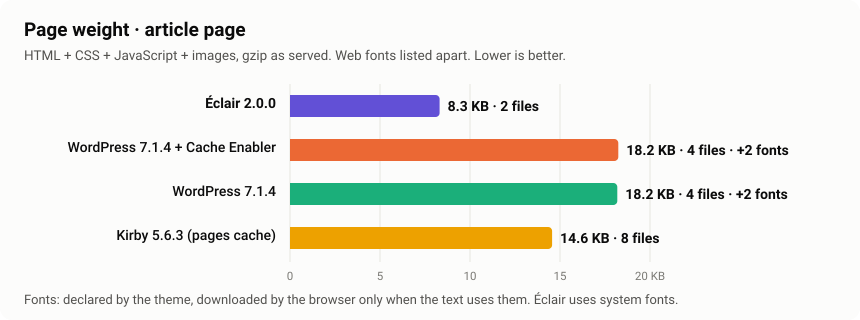

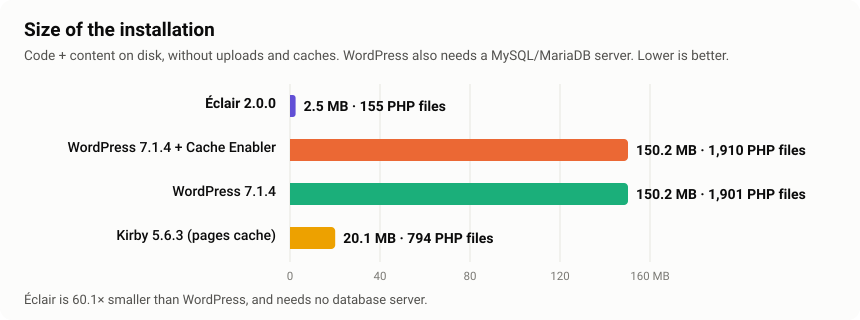

- **Peso de la página** (contado desde el servidor): el HTML más cada hoja de estilo, script e imagen que referencia, en gzip tal como se sirve. Las fuentes web se listan aparte, porque el navegador solo descarga las que usa el texto; el recuento de Lighthouse de arriba las incluye.
- **Instalación**: Éclair 2,5 MB, 155 archivos PHP, sin base de datos. Kirby 20,1 MB, 794 archivos PHP, sin base de datos. WordPress 150 MB, unos 1900 archivos PHP, más un servidor MySQL/MariaDB que mantener, respaldar y proteger.

## 6. Nginx, y WordPress detrás de una caché FastCGI de Nginx

El mismo benchmark en **Nginx**, cada CMS con sus reglas Nginx oficiales, más la configuración que suelen proponer los profesionales de WordPress: **WordPress detrás de una caché FastCGI de Nginx**, donde Nginx sirve las páginas en caché sin llamar a PHP. [Informe completo](results/2026-11-08-nginx-20/).

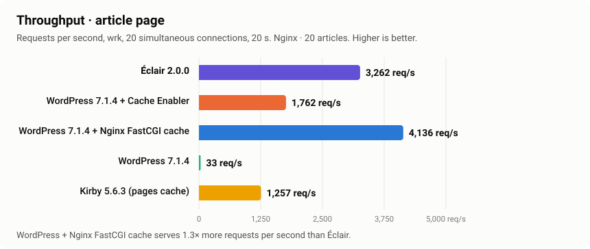

| Página de artículo, Nginx | Tiempo de respuesta | Generada sin caché | Rendimiento | p99 con 100 conexiones | Descarga del navegador |
|---|---:|---:|---:|---:|---:|
| **Éclair** | **0,56 ms** | **3,00 ms** | 3262 req/s | 47,8 ms | **11,6 KB** |
| WordPress + caché FastCGI de Nginx | 0,57 ms | 59,20 ms | **4136 req/s** | **38,8 ms** | 102,1 KB |
| WordPress + Cache Enabler | 1,20 ms | 60,58 ms | 1762 req/s | 88,7 ms | 101,9 KB |
| WordPress | 60,02 ms | 58,07 ms | 33 req/s | 1990 ms | 102,1 KB |
| Kirby (caché de páginas) | 1,63 ms | 3,46 ms | 1257 req/s | 93,8 ms | 23,3 KB |

**Lo que muestra.** Detrás de una caché FastCGI de Nginx, WordPress iguala el tiempo de respuesta de Éclair y atiende **1,3 veces más peticiones por segundo**, porque una página en caché nunca llega a PHP. Esa caché necesita acceso root a Nginx y exclusiones cuidadosas (carritos, usuarios conectados, vistas previas, purga al actualizar), algo que la mayoría de los hostings compartidos no ofrecen, y **cada página que no está en caché sigue costando unos 60 ms en WordPress frente a 3 ms en Éclair**. La misma caché de Nginx, Varnish o una CDN también pueden ponerse delante de Éclair: las cachés externas igualan a todos los CMS en las páginas cacheadas, y lo que queda es el motor de debajo. En lo demás, Nginx confirma los resultados de Apache: Éclair responde **2,1 veces más rápido** que WordPress + Cache Enabler y **2,9 veces más rápido** que Kirby, con **1,9 y 2,6 veces su rendimiento**.

## 7. Sitios grandes: 1000 y 2900 artículos

El mismo benchmark con más contenido (Apache). [Comparación completa](results/large-sites/).

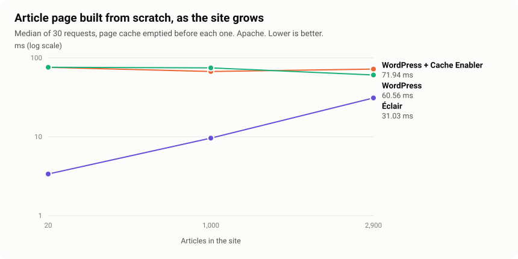

| Generada sin caché | 20 artículos | 1000 | 2900 |
|---|---:|---:|---:|
| **Éclair**, página de lista · artículo | 2,52 · 3,37 ms | 6,63 · 9,61 ms | 19,96 · 31,03 ms |
| WordPress + Cache Enabler | 75,94 · 75,72 ms | 70,86 · 67,14 ms | 70,83 · 71,94 ms |
| WordPress | 75,80 · 75,91 ms | 68,00 · 74,50 ms | 64,75 · 60,56 ms |
| Kirby (caché de páginas) | 5,11 · 3,89 ms | 45,36 · 12,22 ms | 125,39 · 20,76 ms |

| Desde la caché, página de artículo | 20 artículos | 1000 | 2900 |
|---|---:|---:|---:|
| **Éclair** | 1,11 ms · 1997 req/s | 1,30 ms · 2184 req/s | 0,93 ms · 2063 req/s |
| WordPress + Cache Enabler | 1,80 ms · 1060 req/s | 1,72 ms · 1144 req/s | 1,72 ms · 1130 req/s |
| Kirby (caché de páginas) | 1,89 ms · 1106 req/s | 8,01 ms · 302 req/s | 18,18 ms · 128 req/s |

**Lo que muestra.**

- **Desde la caché, el tamaño no cambia nada para Éclair**: un archivo, menos de 1,5 ms, unas 2000 req/s en todos los tamaños. Las páginas de artículo de Kirby en caché se ralentizan mucho (128 req/s con 2900 artículos).
- **Sin caché, Éclair se ralentiza a medida que el sitio crece** (3 → 10 → 31 ms en la página de artículo), porque cada petición sin caché lee todo el índice de contenidos (unos 12 MB de memoria con 2900 artículos). Sigue siendo **entre 2 y 3,5 veces más rápido que WordPress** con 2900 artículos, pero WordPress, con su base de datos indexada, se mantiene estable. Con ese tamaño, Kirby genera una página de artículo más rápido que Éclair (20,8 frente a 31,0 ms), y su página de lista mucho más despacio (125 frente a 20 ms).
- **Éclair 2.x limita un sitio a 3000 contenidos** (artículos + páginas). Los sitios de 10 000 artículos aún no se pueden comparar.

## Qué cambia en la práctica

| Para… | Lo que cambian estas cifras |
|---|---|
| **Propietarios de sitios** | Páginas que empiezan a mostrarse antes en cada visita, también justo después de publicar, sin plugin de caché que elegir, configurar o depurar. El navegador descarga unas 9 veces menos que con el tema por defecto de WordPress. |
| **Agencias y freelancers** | Más sitios por servidor, ninguna base de datos que mantener por cliente, actualizaciones que no pueden romper una pila de plugins. 100 en SEO y accesibilidad en Lighthouse desde la instalación. |
| **Hostings** | Unas 2 veces más visitas con el mismo procesador que WordPress + plugin de caché, entre 20 y 30 veces en páginas sin caché, y unas 10 veces menos memoria PHP por página generada en sitios pequeños. |
| **SEO** | El tiempo de respuesta del servidor es el inicio de cada carga de página, y una página ligera ayuda a las Core Web Vitals. Éclair parte con ambas cosas. |

Lo que este benchmark **no dice**: que Éclair pueda sustituir cualquier sitio WordPress. WordPress tiene un enorme ecosistema de plugins, multisitio, veinte años de madurez y se mantiene estable en sitios muy grandes. Éclair está pensado para sitios de contenido (blogs, webs de pequeñas empresas, webs corporativas) de hasta unos pocos miles de páginas.

## Cómo se mide

| | |
|---|---|
| **Sitios** | Éclair (archivo oficial, SHA-256 guardado) · WordPress (repositorio oficial de build, etiqueta de versión, tema por defecto) · WordPress + [Cache Enabler](https://github.com/keycdn/cache-enabler) (ajustes por defecto) · WordPress + caché FastCGI de Nginx (mediciones Nginx) · Kirby [Starterkit](https://github.com/getkirby/starterkit) (caché de páginas activa) |
| **Contenido** | Los mismos artículos en cada sitio ([content/](content/)); contenido de ejemplo eliminado; 10 artículos por página de lista en todos |
| **Servidor** | Un solo servidor web (Apache 2.4 con `.htaccess`, o Nginx con las reglas oficiales de cada CMS), un solo pool PHP 8.3 FPM con OPcache, gzip para todos, ajustes por defecto de Ubuntu |
| **Peticiones** | Cabeceras de un Chrome real en cada petición |
| **Tiempo de respuesta** | TTFB con `curl`, 50 peticiones de calentamiento + 300 peticiones, mediana y p95 |
| **Sin caché** | Caché vaciada antes de cada una de las 30 peticiones |
| **Carga** | [wrk](https://github.com/wg/wrk), 20 conexiones × 20 s; escalabilidad con 1, 10, 50 y 100 conexiones × 10 s |
| **Navegador** | Lighthouse 12.8 en Chromium, ajustes de PageSpeed Insights, mediana de 5 pasadas |
| **Dentro de una petición** | Pasada de perfilado separada con `auto_prepend_file`, retirada antes de medir tiempos |
| **Orden** | Un sitio a la vez, los demás en reposo |

Cada detalle y el motivo de cada decisión: [docs/METHODOLOGY.md](docs/METHODOLOGY.md).

## Límites

- **Máquina pequeña y compartida.** 2 vCPU, con el generador de carga en la misma máquina. Las cifras absolutas serán más altas en un servidor real; compara las diferencias. Se admite una máquina de carga separada (`BENCH_LOAD_SSH`), pero aún no se ha usado en las mediciones publicadas.
- **Ajustes por defecto en todo.** PHP-FPM mantiene los 5 procesos de Ubuntu.
- **Diseños por defecto distintos.** El peso y Lighthouse comparan instalaciones por defecto, no páginas idénticas.
- **Métricas de laboratorio** para las Core Web Vitals; los datos de campo necesitan visitantes reales.
- **Aún sin probar:** WP Rocket (plugin de pago), LiteSpeed y LiteSpeed Cache (servidor LiteSpeed), Grav, Drupal, Statamic (Composer) y Ghost (Node.js). Ver la [hoja de ruta](#hoja-de-ruta).

## Ejecútalo tú mismo

Necesitas un **servidor Ubuntu 24.04 nuevo** (basta un VPS pequeño: 2 vCPU, 2 GB de RAM). No uses un servidor de producción: el script instala y reconfigura el servidor web, PHP-FPM y MariaDB.

```bash
git clone https://github.com/Jacckisback/eclair-benchmarks
cd eclair-benchmarks
sudo ./run.sh                                        # Apache, 20 artículos, Lighthouse: unos 30 minutos
sudo BENCH_SERVER=nginx ./run.sh                     # Nginx, añade WordPress + caché FastCGI de Nginx
sudo BENCH_ARTICLES=1000 BENCH_LIGHTHOUSE=0 ./run.sh # un sitio más grande
```

El informe aparece al final y se guarda, con el JSON bruto y los gráficos SVG, en `results/<fecha>-<nombre del servidor>-<servidor web>-<artículos>/`. Todas las opciones (sitios probados, máquina de carga separada, Chrome que usar, duraciones) están en el [README en inglés](README.md#run-it-yourself).

## Hoja de ruta

- [x] Lighthouse en un navegador real (Core Web Vitals de laboratorio, SEO, accesibilidad)
- [x] Sitios grandes: 1000 y 2900 artículos (el máximo actual de Éclair es de 3000 contenidos)
- [x] Nginx + PHP-FPM
- [x] WordPress + caché FastCGI de Nginx
- [x] Kirby
- [x] Soporte de una máquina de carga separada (`BENCH_LOAD_SSH`)
- [ ] Mediciones publicadas en un servidor dedicado con una máquina de carga separada
- [ ] Sitios de 10 000 artículos (Éclair tiene que superar su límite de 3000 contenidos)
- [ ] LiteSpeed + LiteSpeed Cache, WP Rocket
- [ ] Ghost, Grav, Drupal, Statamic
- [ ] Core Web Vitals de campo en sitios reales

## Contribuir

- **¿Un ajuste injusto o un error?** [Abre un issue](https://github.com/Jacckisback/eclair-benchmarks/issues). Se corregirá y se publicará una nueva medición.
- **¿Otro CMS u otra configuración?** Añade su script de instalación en `lib/` y un caso en `run.sh`, siguiendo las mismas reglas (versión oficial, tema por defecto, mismos artículos, mismo servidor), y abre una pull request.
- **¿Lo has ejecutado en tu servidor?** Abre una pull request con tu carpeta `results/`: resultados de máquinas distintas refuerzan la comparación.

## Licencia

MIT para los scripts de este repositorio. Éclair CMS está bajo AGPL-3.0; WordPress y Cache Enabler bajo GPL-2.0 o posterior; Kirby es un producto comercial (gratuito para probarlo en local).
