<p align="center"><a href="README.md">English</a> · <b>Français</b> · <a href="README.es.md">Español</a></p>

<p align="center">
  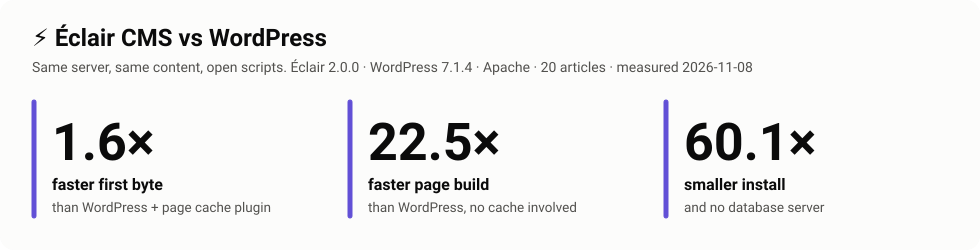
</p>

<p align="center">
  <a href="LICENSE"></a>
  
  
  
  
  
  
</p>

# Benchmarks d'Éclair CMS

**Des tests de performance ouverts et reproductibles d'[Éclair CMS](https://github.com/Jacckisback/eclair-cms) face à WordPress (avec et sans cache) et à Kirby.** Même serveur, même PHP, même contenu, versions officielles, réglages par défaut. Un seul script installe chaque site, le mesure côté serveur et dans un vrai navigateur, et dessine chaque graphique de cette page à partir des données brutes.

> **En toute transparence.** Éclair est développé par l'auteur de ce dépôt. C'est justement pour ça que tout est public : la méthode, les scripts, le contenu, le JSON brut de chaque mesure, et les résultats où Éclair perd (ils sont aussi dans ce README). Ne crois pas ces chiffres sur parole, [lance le test toi-même](#le-lancer-toi-même). Si tu trouves un réglage qui avantage Éclair, [ouvre une issue](https://github.com/Jacckisback/eclair-benchmarks/issues) : il sera corrigé et une nouvelle mesure publiée, même si le résultat est moins bon pour Éclair.

Les graphiques sont en anglais (une seule version pour les trois langues) ; les chiffres sont repris dans les tableaux.

## Sommaire

- [Les résultats en bref](#les-résultats-en-bref)
- [1. Temps de réponse](#1-temps-de-réponse) · [2. Construire une page sans cache](#2-construire-une-page-sans-cache) · [3. Débit et montée en charge](#3-débit-et-montée-en-charge)
- [4. Dans un vrai navigateur : Lighthouse](#4-dans-un-vrai-navigateur--lighthouse)
- [Ce qui se passe dans une requête](#ce-qui-se-passe-dans-une-requête)
- [5. Poids des pages et taille de l'installation](#5-poids-des-pages-et-taille-de-linstallation)
- [6. Nginx, et WordPress derrière un cache FastCGI de Nginx](#6-nginx-et-wordpress-derrière-un-cache-fastcgi-de-nginx)
- [7. Gros sites : 1 000 et 2 900 articles](#7-gros-sites--1-000-et-2-900-articles)
- [Ce que ça change concrètement](#ce-que-ça-change-concrètement) · [Comment c'est mesuré](#comment-cest-mesuré) · [Limites](#limites) · [Le lancer toi-même](#le-lancer-toi-même) · [Feuille de route](#feuille-de-route)
- Pour aller plus loin (en anglais) : [FAQ pour les pros de WordPress](docs/FAQ.md) · [Méthodologie](docs/METHODOLOGY.md) · [Architecture](docs/ARCHITECTURE.md)

## Les résultats en bref

Mesures du **8 novembre 2026** · Éclair 2.0.0 · WordPress 7.1.4 (thème par défaut Twenty Twenty-Five) · Cache Enabler 1.8.16 · Kirby 5.6.3 (Starterkit, cache de pages actif) · machine cloud 2 vCPU, Ubuntu 24.04, PHP 8.3 FPM avec OPcache, MariaDB 10.11

| Mesure | Serveur web | Articles | Rapport |
|---|---|---:|---|
| Mesure principale | Apache 2.4 | 20 | [results/2026-11-08-apache-20](results/2026-11-08-apache-20/) |
| Mesure Nginx (ajoute WordPress + cache FastCGI de Nginx) | Nginx 1.24 | 20 | [results/2026-11-08-nginx-20](results/2026-11-08-nginx-20/) |
| Gros sites | Apache 2.4 | 1 000 · 2 900 | [results/large-sites](results/large-sites/) |

**Page article, Apache, 20 articles**

| | Temps de réponse<br><sub>TTFB médian</sub> | Construite sans cache<br><sub>cache vidé</sub> | Débit<br><sub>20 connexions</sub> | Fichiers PHP<br><sub>par page vue</sub> | LCP Lighthouse<br><sub>mobile, 4G lente</sub> | Téléchargé par le navigateur<br><sub>Lighthouse</sub> |
|---|---:|---:|---:|---:|---:|---:|
| **Éclair 2.0.0** | **1,11 ms** | **3,37 ms** | **1 997 req/s** | **1** | **0,95 s** | **10,8 Ko** |
| WordPress 7.1.4 + Cache Enabler | 1,80 ms | 75,72 ms | 1 060 req/s | 27 | 1,50 s | 97,6 Ko |
| WordPress 7.1.4, sans extension | 75,64 ms | 75,91 ms | 31 req/s | 496 (+32 SQL) | 1,50 s | 97,8 Ko |
| Kirby 5.6.3, cache de pages | 1,89 ms | 3,89 ms | 1 106 req/s | 131 | 1,14 s | 23,0 Ko |

**En bref :**

- Face à **WordPress avec une extension de cache**, Éclair répond **1,6× plus vite**, sert **1,9× plus de visiteurs** sur le même serveur, et ses pages font télécharger **9× moins** au navigateur.
- Quand aucun cache ne peut aider (première visite après une modification, pages impossibles à mettre en cache), Éclair construit une page **22 à 30× plus vite** que WordPress.
- Face à **Kirby**, le CMS à fichiers plats le plus proche, Éclair est **1,6 à 1,7× plus rapide** depuis le cache et sert **1,8× plus de requêtes** par seconde.
- Là où Éclair **ne gagne pas** : derrière un **cache FastCGI de Nginx**, WordPress sert **1,3× plus de requêtes par seconde** (Nginx répond sans PHP), et sur les **gros sites** la construction des pages hors cache d'Éclair ralentit (31 ms à 2 900 articles). Les deux sont détaillés plus bas.

## 1. Temps de réponse

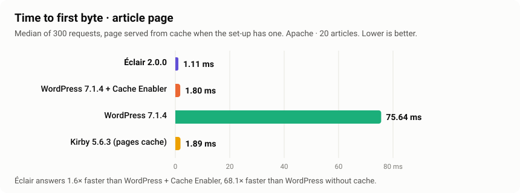

Temps jusqu'au premier octet, médiane de 300 requêtes après 50 requêtes de chauffe, mesuré sur le serveur (réseau exclu). C'est ce qu'attend un visiteur avant que le navigateur puisse commencer à afficher la page.

| | Page de liste : médiane · p95 | Article : médiane · p95 |
|---|---:|---:|
| **Éclair** | **1,15 ms · 1,78 ms** | **1,11 ms · 1,51 ms** |
| WordPress + Cache Enabler | 1,90 ms · 2,23 ms | 1,80 ms · 2,17 ms |
| WordPress | 74,18 ms · 96,12 ms | 75,64 ms · 98,72 ms |
| Kirby (cache de pages) | 1,83 ms · 2,29 ms | 1,89 ms · 3,05 ms |

## 2. Construire une page sans cache

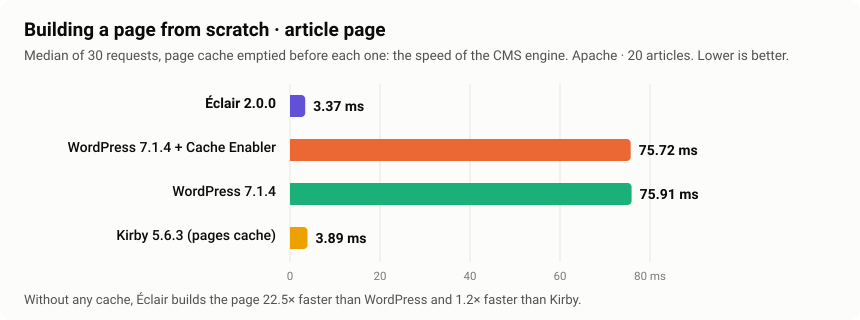

Le cache est vidé avant chacune des 30 requêtes : c'est la vitesse du moteur du CMS, et ce que reçoivent les visiteurs **à la première visite après chaque modification** et sur les pages **impossibles à mettre en cache** (aperçus, recherche, utilisateurs connectés). Une extension de cache ne peut pas aider WordPress ici : Éclair est **22,5× plus rapide sur la page article et 30× sur la page de liste**. Kirby, qui lit aussi des fichiers plats, est proche d'Éclair à cette taille de site.

## 3. Débit et montée en charge

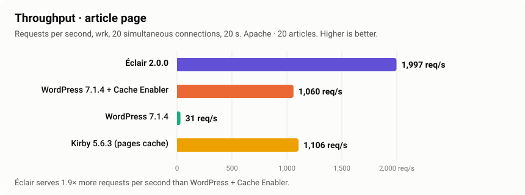

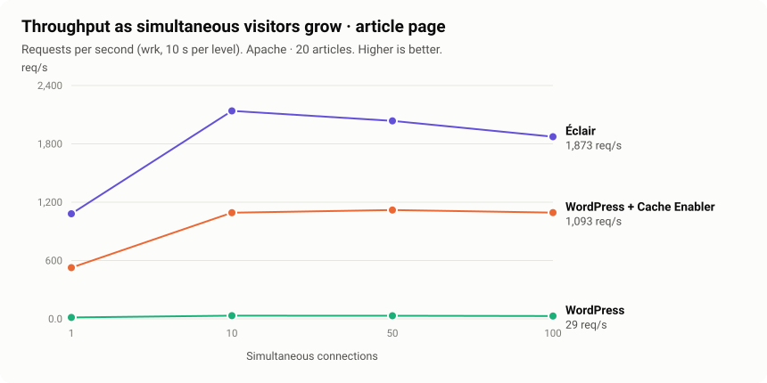

| Page article, Apache | 1 connexion | 10 | 50 | 100 |
|---|---:|---:|---:|---:|
| **Éclair** | 1 081 req/s · p99 1,7 ms | 2 139 · p99 10,8 ms | 2 036 · p99 34,3 ms | 1 873 · p99 194,5 ms |
| WordPress + Cache Enabler | 527 · p99 3,0 ms | 1 092 · p99 18,1 ms | 1 119 · p99 61,7 ms | 1 093 · p99 119,7 ms |
| WordPress | 15 · p99 105,8 ms | 33 · p99 400 ms | 32 · p99 1 690 ms | 29 · p99 2 000 ms |
| Kirby (cache de pages) | 512 · p99 3,2 ms | 1 127 · p99 14,7 ms | 1 122 · p99 58,6 ms | 1 091 · p99 150,8 ms |

Le débit plafonne dès 10 connexions : sur cette machine 2 vCPU, le processeur, partagé avec le générateur de charge, est la limite. Éclair garde **1,7 à 2× le débit** de WordPress + cache et de Kirby à chaque niveau.

**Publié tel quel :** à 100 connexions sous Apache, la latence p99 d'Éclair (195 ms) est plus haute que celle de WordPress + cache (120 ms). Sous Nginx c'est l'inverse (Éclair 48 ms, WordPress + Cache Enabler 89 ms, voir la [section 6](#6-nginx-et-wordpress-derrière-un-cache-fastcgi-de-nginx)) : cette traîne semble liée à la file d'attente d'Apache devant PHP-FPM sur une petite machine. À confirmer avec une machine de charge séparée.

## 4. Dans un vrai navigateur : Lighthouse

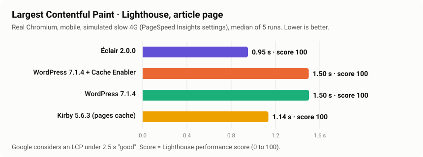

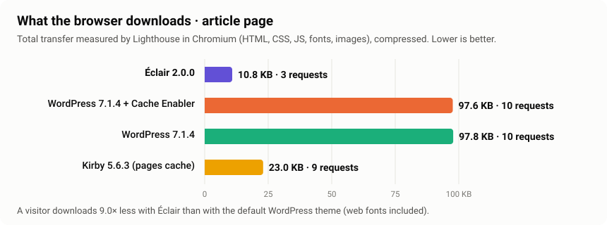

Lighthouse 12.8 dans un vrai Chromium, avec les réglages de PageSpeed Insights (mobile, 4G lente simulée, processeur ralenti 4×), médiane de 5 passages.

| Page article | Performance | LCP | FCP | TBT | CLS | Transfert | Requêtes | Accessibilité | Bonnes pratiques | SEO |
|---|---:|---:|---:|---:|---:|---:|---:|---:|---:|---:|
| **Éclair** | **100** | **0,95 s** | **0,72 s** | 0 ms | 0 | **10,8 Ko** | **3** | **100** | **100** | **100** |
| WordPress + Cache Enabler | 100 | 1,50 s | 0,75 s | 18 ms | 0 | 97,6 Ko | 10 | 100 | 100 | 92 |
| WordPress | 100 | 1,50 s | 0,75 s | 50 ms | 0 | 97,8 Ko | 10 | 100 | 100 | 92 |
| Kirby (cache de pages) | 100 | 1,14 s | 1,14 s | 0 ms | 0 | 23,0 Ko | 9 | 94 | 100 | 90 |

Toutes les configurations atteignent le score de performance maximal sur ces petites pages ; les mesures en dessous montrent la différence. Le LCP d'Éclair est **0,55 s plus court** que celui de WordPress, le navigateur télécharge **9× moins**, et Éclair est le seul à **100 en SEO** (WordPress 92, Kirby 90). Ce sont des mesures de laboratoire ; les Core Web Vitals de terrain (dont l'INP) demandent de vrais visiteurs.

## Ce qui se passe dans une requête

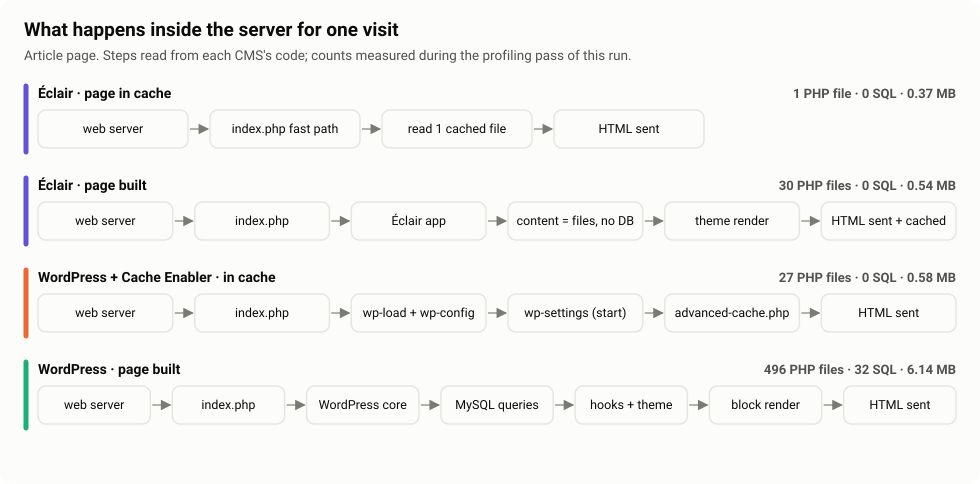

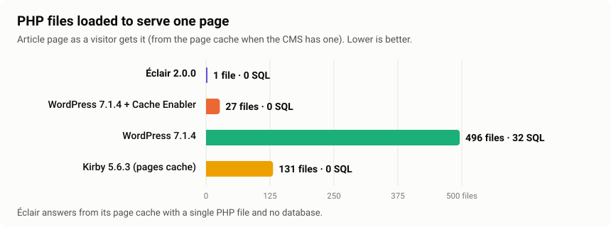

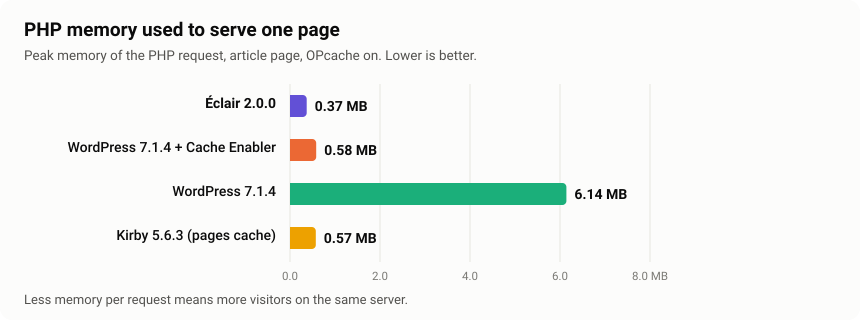

Mesuré lors d'une passe de profilage séparée (un `auto_prepend_file` qui enregistre `get_included_files()`, `memory_get_peak_usage()` et `$wpdb->num_queries` en fin de requête), retirée avant toute mesure de temps.

- **Éclair répond avec un seul fichier PHP.** Son `index.php` regarde le cache *avant même que l'application existe* : il lit quelques octets de réglages, ouvre `cache/pages/<md5(chemin)>`, vérifie la génération du cache, envoie les en-têtes enregistrés avec un `ETag` (et répond `304 Not Modified` quand c'est possible), transmet le HTML et s'arrête. L'invalidation est atomique : chaque modification publie une nouvelle génération de cache *avant* de supprimer les anciennes pages, donc une page périmée n'est jamais servie.
- **WordPress + Cache Enabler charge 27 fichiers** : `advanced-cache.php` est chargé par `wp-settings.php`, après `wp-load.php` et `wp-config.php`.
- **Le cache de pages de Kirby charge 131 fichiers** : il est servi par le routeur de Kirby, après le chargement du cœur.
- **WordPress sans cache charge ~500 fichiers et fait ~30 requêtes SQL** : le cœur, les options chargées automatiquement, la requête principale, la hiérarchie des modèles et le thème en blocs.

Explication détaillée avec références au code : [docs/ARCHITECTURE.md](docs/ARCHITECTURE.md).

## 5. Poids des pages et taille de l'installation

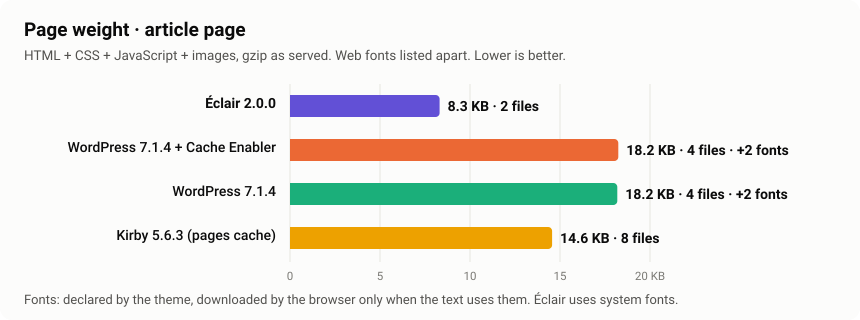

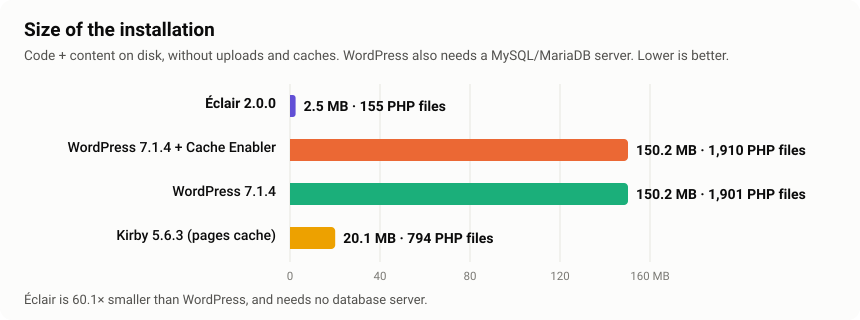

- **Poids de la page** (compté côté serveur) : le HTML plus chaque feuille de style, script et image qu'il appelle, en gzip comme servi. Les polices web sont listées à part, car le navigateur ne télécharge que celles que le texte utilise ; le décompte de Lighthouse ci-dessus les inclut.
- **Installation** : Éclair 2,5 Mo, 155 fichiers PHP, sans base de données. Kirby 20,1 Mo, 794 fichiers PHP, sans base de données. WordPress 150 Mo, environ 1 900 fichiers PHP, plus un serveur MySQL/MariaDB à faire tourner, sauvegarder et sécuriser.

## 6. Nginx, et WordPress derrière un cache FastCGI de Nginx

Le même benchmark sous **Nginx**, chaque CMS avec ses règles Nginx officielles, plus la configuration que les pros de WordPress mettent souvent en avant : **WordPress derrière un cache FastCGI de Nginx**, où Nginx sert les pages en cache sans appeler PHP. [Rapport complet](results/2026-11-08-nginx-20/).

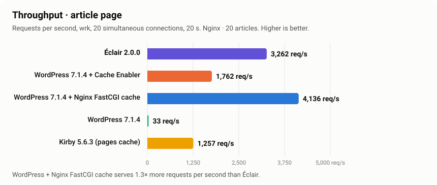

| Page article, Nginx | Temps de réponse | Construite sans cache | Débit | p99 à 100 connexions | Téléchargé par le navigateur |
|---|---:|---:|---:|---:|---:|
| **Éclair** | **0,56 ms** | **3,00 ms** | 3 262 req/s | 47,8 ms | **11,6 Ko** |
| WordPress + cache FastCGI de Nginx | 0,57 ms | 59,20 ms | **4 136 req/s** | **38,8 ms** | 102,1 Ko |
| WordPress + Cache Enabler | 1,20 ms | 60,58 ms | 1 762 req/s | 88,7 ms | 101,9 Ko |
| WordPress | 60,02 ms | 58,07 ms | 33 req/s | 1 990 ms | 102,1 Ko |
| Kirby (cache de pages) | 1,63 ms | 3,46 ms | 1 257 req/s | 93,8 ms | 23,3 Ko |

**Ce que ça montre.** Derrière un cache FastCGI de Nginx, WordPress égale le temps de réponse d'Éclair et sert **1,3× plus de requêtes par seconde**, parce qu'une page en cache n'atteint jamais PHP. Ce cache demande un accès root à Nginx et des exclusions soignées (paniers, utilisateurs connectés, aperçus, purge à la mise à jour), ce que la plupart des hébergements mutualisés ne proposent pas, et **chaque page absente du cache coûte toujours environ 60 ms sur WordPress contre 3 ms sur Éclair**. Le même cache Nginx, Varnish ou un CDN peuvent aussi être placés devant Éclair : les caches extérieurs mettent tous les CMS à égalité sur les pages en cache, et il reste le moteur en dessous. Pour le reste, Nginx confirme les résultats d'Apache : Éclair répond **2,1× plus vite** que WordPress + Cache Enabler et **2,9× plus vite** que Kirby, avec **1,9× et 2,6× leur débit**.

## 7. Gros sites : 1 000 et 2 900 articles

Le même benchmark avec plus de contenu (Apache). [Comparaison complète](results/large-sites/).

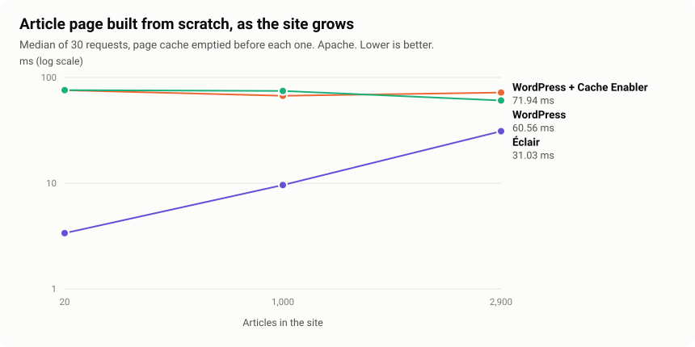

| Construite sans cache | 20 articles | 1 000 | 2 900 |
|---|---:|---:|---:|
| **Éclair**, page de liste · article | 2,52 · 3,37 ms | 6,63 · 9,61 ms | 19,96 · 31,03 ms |
| WordPress + Cache Enabler | 75,94 · 75,72 ms | 70,86 · 67,14 ms | 70,83 · 71,94 ms |
| WordPress | 75,80 · 75,91 ms | 68,00 · 74,50 ms | 64,75 · 60,56 ms |
| Kirby (cache de pages) | 5,11 · 3,89 ms | 45,36 · 12,22 ms | 125,39 · 20,76 ms |

| Depuis le cache, page article | 20 articles | 1 000 | 2 900 |
|---|---:|---:|---:|
| **Éclair** | 1,11 ms · 1 997 req/s | 1,30 ms · 2 184 req/s | 0,93 ms · 2 063 req/s |
| WordPress + Cache Enabler | 1,80 ms · 1 060 req/s | 1,72 ms · 1 144 req/s | 1,72 ms · 1 130 req/s |
| Kirby (cache de pages) | 1,89 ms · 1 106 req/s | 8,01 ms · 302 req/s | 18,18 ms · 128 req/s |

**Ce que ça montre.**

- **Depuis le cache, la taille ne change rien pour Éclair** : un fichier, moins de 1,5 ms, environ 2 000 req/s à toutes les tailles. Les pages article de Kirby en cache ralentissent fortement (128 req/s à 2 900 articles).
- **Sans cache, Éclair ralentit quand le site grossit** (3 → 10 → 31 ms sur la page article), parce que chaque requête hors cache lit tout l'index des contenus (environ 12 Mo de mémoire à 2 900 articles). Il reste **2 à 3,5× plus rapide que WordPress** à 2 900 articles, mais WordPress, avec sa base de données indexée, reste stable. À cette taille, Kirby construit une page article plus vite qu'Éclair (20,8 contre 31,0 ms), et sa page de liste beaucoup plus lentement (125 contre 20 ms).
- **Éclair 2.x limite un site à 3 000 contenus** (articles + pages). Les sites de 10 000 articles ne peuvent pas encore être comparés.

## Ce que ça change concrètement

| Pour… | Ce que ces chiffres changent |
|---|---|
| **Les propriétaires de sites** | Des pages qui s'affichent plus tôt à chaque visite, y compris juste après une publication, sans extension de cache à choisir, régler ou dépanner. Le navigateur télécharge environ 9× moins qu'avec le thème WordPress par défaut. |
| **Les agences et freelances** | Plus de sites par serveur, aucune base de données à maintenir par client, des mises à jour qui ne peuvent pas casser une pile d'extensions. 100 en SEO et en accessibilité dans Lighthouse dès l'installation. |
| **Les hébergeurs** | Environ 2× plus de visiteurs sur le même processeur qu'avec WordPress + extension de cache, 20 à 30× sur les pages hors cache, et environ 10× moins de mémoire PHP par page construite sur les petits sites. |
| **Le SEO** | Le temps de réponse du serveur est le début de chaque chargement de page, et une page légère aide les Core Web Vitals. Éclair part avec les deux. |

Ce que ce benchmark **ne dit pas** : qu'Éclair peut remplacer n'importe quel site WordPress. WordPress a un énorme écosystème d'extensions, le multisite, vingt ans de maturité, et reste stable sur les très gros sites. Éclair est conçu pour les sites de contenu (blogs, sites de petites entreprises, sites vitrines) jusqu'à quelques milliers de pages.

## Comment c'est mesuré

| | |
|---|---|
| **Sites** | Éclair (archive officielle, SHA-256 enregistré) · WordPress (dépôt officiel de build, tag de version, thème par défaut) · WordPress + [Cache Enabler](https://github.com/keycdn/cache-enabler) (réglages par défaut) · WordPress + cache FastCGI de Nginx (mesures Nginx) · Kirby [Starterkit](https://github.com/getkirby/starterkit) (cache de pages actif) |
| **Contenu** | Les mêmes articles sur chaque site ([content/](content/)) ; contenus d'exemple supprimés ; 10 articles par page de liste partout |
| **Serveur** | Un seul serveur web (Apache 2.4 avec `.htaccess`, ou Nginx avec les règles officielles de chaque CMS), un seul pool PHP 8.3 FPM avec OPcache, gzip pour tous, réglages Ubuntu par défaut |
| **Requêtes** | En-têtes d'un vrai Chrome à chaque requête |
| **Temps de réponse** | TTFB `curl`, 50 requêtes de chauffe + 300 requêtes, médiane et p95 |
| **Sans cache** | Cache vidé avant chacune des 30 requêtes |
| **Charge** | [wrk](https://github.com/wg/wrk), 20 connexions × 20 s ; montée en charge à 1, 10, 50, 100 connexions × 10 s |
| **Navigateur** | Lighthouse 12.8 dans Chromium, réglages de PageSpeed Insights, médiane de 5 passages |
| **Dans une requête** | Passe de profilage séparée avec `auto_prepend_file`, retirée avant les mesures de temps |
| **Ordre** | Un site à la fois, les autres au repos |

Chaque détail et la raison de chaque choix : [docs/METHODOLOGY.md](docs/METHODOLOGY.md).

## Limites

- **Petite machine partagée.** 2 vCPU, avec le générateur de charge sur la même machine. Les chiffres absolus seront plus hauts sur un vrai serveur ; compare les écarts. Une machine de charge séparée est prise en charge (`BENCH_LOAD_SSH`) mais n'a pas encore servi pour les mesures publiées.
- **Réglages par défaut partout.** PHP-FPM garde les 5 processus d'Ubuntu.
- **Designs par défaut différents.** Le poids et Lighthouse comparent des installations par défaut, pas des pages identiques.
- **Mesures de laboratoire** pour les Core Web Vitals ; les données de terrain demandent de vrais visiteurs.
- **Pas encore testés :** WP Rocket (extension payante), LiteSpeed et LiteSpeed Cache (serveur LiteSpeed), Grav, Drupal, Statamic (Composer) et Ghost (Node.js). Voir la [feuille de route](#feuille-de-route).

## Le lancer toi-même

Il faut un **serveur Ubuntu 24.04 neuf** (un petit VPS suffit : 2 vCPU, 2 Go de RAM). Pas de serveur de production : le script installe et reconfigure le serveur web, PHP-FPM et MariaDB.

```bash
git clone https://github.com/Jacckisback/eclair-benchmarks
cd eclair-benchmarks
sudo ./run.sh                                        # Apache, 20 articles, Lighthouse : environ 30 minutes
sudo BENCH_SERVER=nginx ./run.sh                     # Nginx, ajoute WordPress + cache FastCGI de Nginx
sudo BENCH_ARTICLES=1000 BENCH_LIGHTHOUSE=0 ./run.sh # un site plus gros
```

Le rapport s'affiche à la fin et il est enregistré, avec le JSON brut et les graphiques SVG, dans `results/<date>-<nom du serveur>-<serveur web>-<articles>/`. Toutes les options (sites testés, machine de charge séparée, Chrome à utiliser, durées) sont décrites dans le [README en anglais](README.md#run-it-yourself).

## Feuille de route

- [x] Lighthouse dans un vrai navigateur (Core Web Vitals de laboratoire, SEO, accessibilité)
- [x] Gros sites : 1 000 et 2 900 articles (le maximum actuel d'Éclair est de 3 000 contenus)
- [x] Nginx + PHP-FPM
- [x] WordPress + cache FastCGI de Nginx
- [x] Kirby
- [x] Prise en charge d'une machine de charge séparée (`BENCH_LOAD_SSH`)
- [ ] Mesures publiées sur un serveur dédié avec une machine de charge séparée
- [ ] Sites de 10 000 articles (il faut qu'Éclair lève sa limite de 3 000 contenus)
- [ ] LiteSpeed + LiteSpeed Cache, WP Rocket
- [ ] Ghost, Grav, Drupal, Statamic
- [ ] Core Web Vitals de terrain sur de vrais sites

## Contribuer

- **Un réglage injuste ou une erreur ?** [Ouvre une issue](https://github.com/Jacckisback/eclair-benchmarks/issues). Elle sera corrigée et une nouvelle mesure publiée.
- **Un autre CMS ou une autre configuration ?** Ajoute son script d'installation dans `lib/` et un cas dans `run.sh`, en suivant les mêmes règles (version officielle, thème par défaut, mêmes articles, même serveur), et ouvre une pull request.
- **Tu l'as lancé sur ton serveur ?** Ouvre une pull request avec ton dossier `results/` : des résultats sur des machines différentes renforcent la comparaison.

## Licence

MIT pour les scripts de ce dépôt. Éclair CMS est sous AGPL-3.0 ; WordPress et Cache Enabler sous GPL-2.0 ou ultérieure ; Kirby est un produit commercial (gratuit pour l'essai en local).
