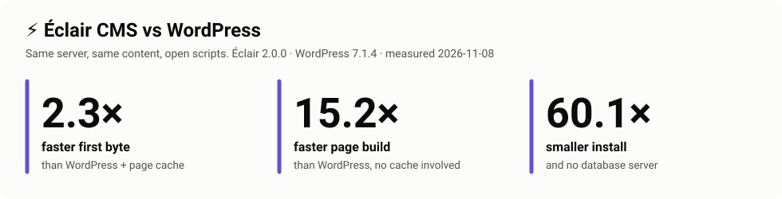
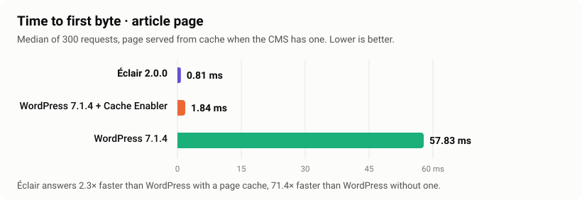
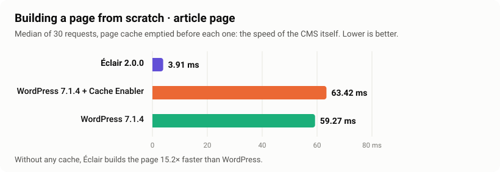
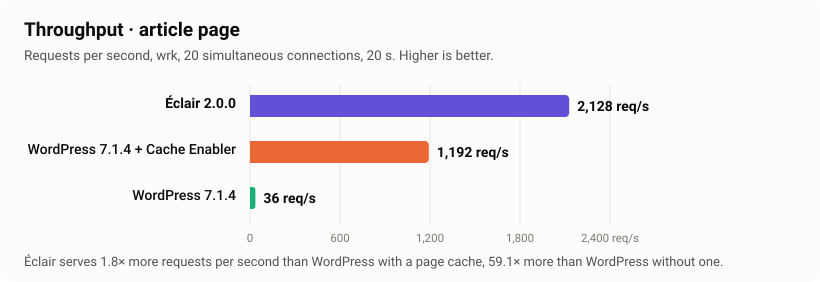
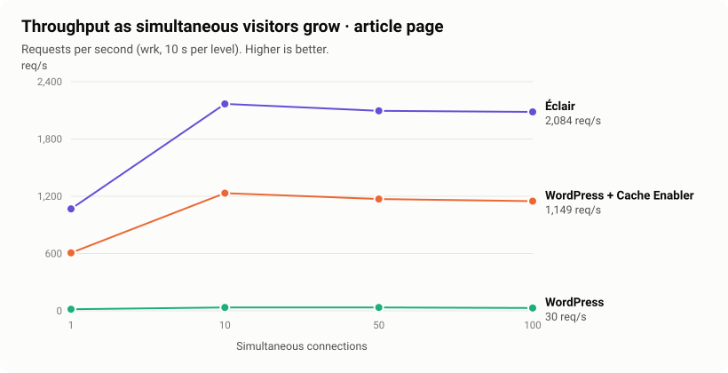
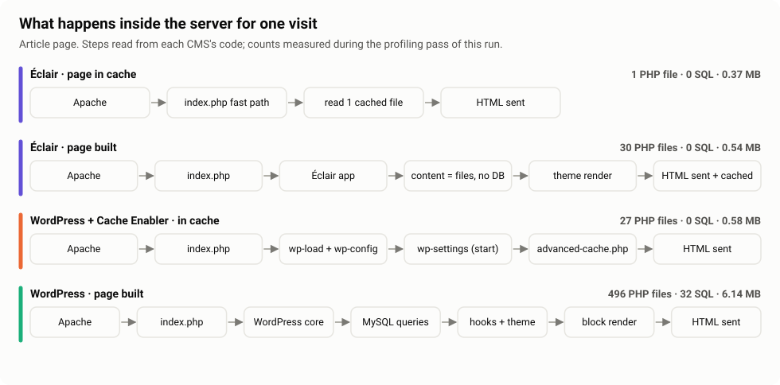
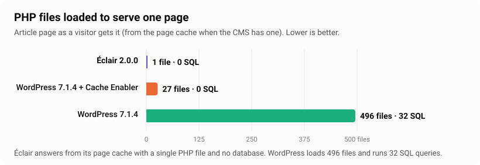
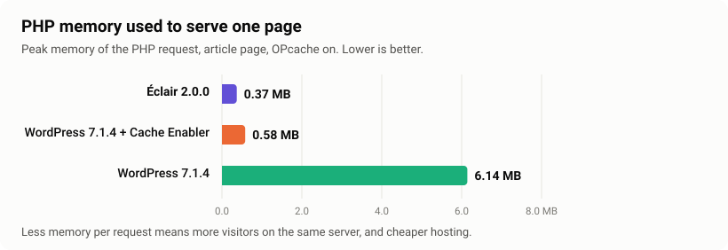
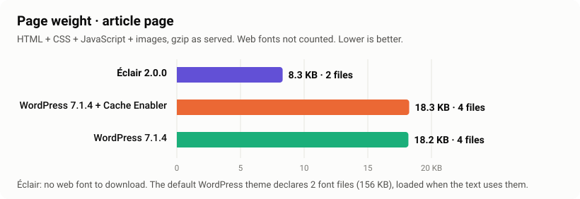
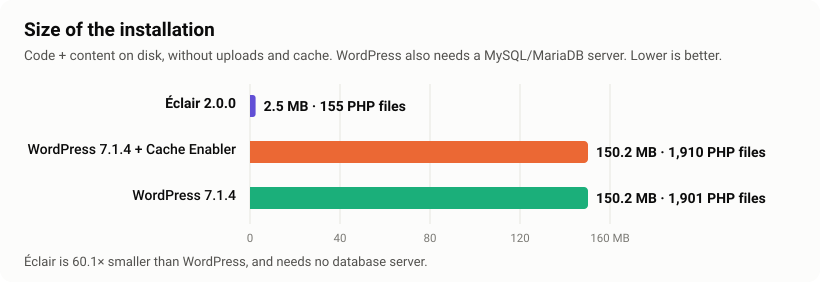

<p align="center"><b>English</b> · <a href="README.fr.md">Français</a> · <a href="README.es.md">Español</a></p>

<p align="center">
  
</p>

<p align="center">
  <a href="LICENSE"></a>
  
  
  
  
</p>

# Éclair CMS benchmarks

**Open, reproducible performance tests of [Éclair CMS](https://github.com/Jacckisback/eclair-cms) against WordPress.** Same server, same PHP, same content, official releases, default settings. One script installs the three sites, measures them and draws every chart on this page from the raw data.

> **Full disclosure.** Éclair is developed by the author of this repository. That is exactly why everything is public: the method, the scripts, the content, the raw JSON of every run. Do not trust these numbers, [run them yourself](#run-it-yourself) on your own server in about 15 minutes. If you find a setting that favours Éclair, [open an issue](https://github.com/Jacckisback/eclair-benchmarks/issues): it will be fixed and a new run published, even if the result is worse for Éclair.

## Contents

- [Results at a glance](#results-at-a-glance)
- [Response time](#1-response-time)
- [Building a page from scratch](#2-building-a-page-from-scratch)
- [Throughput and scaling](#3-throughput-and-scaling)
- [What's inside one request](#whats-inside-one-request)
- [Page weight and installation size](#4-page-weight-and-installation-size)
- [What it means in practice](#what-it-means-in-practice)
- [How it is measured](#how-it-is-measured)
- [Limits](#limits)
- [Run it yourself](#run-it-yourself)
- [FAQ for WordPress professionals](docs/FAQ.md) · [Methodology](docs/METHODOLOGY.md) · [Architecture](docs/ARCHITECTURE.md)

## Results at a glance

Run of **8 November 2026** · Éclair 2.0.0 · WordPress 7.1.4 (default theme Twenty Twenty-Five) · Cache Enabler 1.8.16 · 2 vCPU cloud machine, Ubuntu 24.04, Apache 2.4 (mpm_event) + PHP 8.3 FPM with OPcache, MariaDB 10.11 · [full report and raw data](results/2026-11-08-cloud-2vcpu/)

**Article page**

| | Response time<br><sub>median TTFB</sub> | Page built from scratch<br><sub>cache emptied</sub> | Throughput<br><sub>20 connections</sub> | PHP files<br><sub>per page view</sub> | SQL queries<br><sub>per page view</sub> | Page weight<br><sub>gzip</sub> |
|---|---:|---:|---:|---:|---:|---:|
| **Éclair 2.0.0** | **0.81 ms** | **3.91 ms** | **2,128 req/s** | **1** | **0** | **8.3 KB** |
| WordPress 7.1.4 + Cache Enabler | 1.84 ms | 63.42 ms | 1,192 req/s | 27 | 0 | 18.3 KB |
| WordPress 7.1.4, no plugin | 57.83 ms | 59.27 ms | 36 req/s | 496 | 32 | 18.2 KB |

**Home page (list of 10 articles)**

| | Response time | Page built from scratch | Throughput | PHP files | SQL queries | Page weight |
|---|---:|---:|---:|---:|---:|---:|
| **Éclair 2.0.0** | **1.02 ms** | **2.58 ms** | **2,273 req/s** | **1** | **0** | **7.6 KB** |
| WordPress 7.1.4 + Cache Enabler | 1.83 ms | 61.57 ms | 1,220 req/s | 27 | 0 | 14.5 KB |
| WordPress 7.1.4, no plugin | 61.73 ms | 60.84 ms | 33 req/s | 494 | 25 | 14.4 KB |

**In one sentence:** against WordPress *with* a page cache, Éclair answers about **2× faster** and serves about **2× more visitors** on the same server; when no cache can help, it builds a page **15 to 24× faster**; and it installs in **2.5 MB without a database**, against 150 MB plus MySQL.

## 1. Response time



Time to first byte, median of 300 requests after 50 warm-up requests. This is what a visitor waits for before the browser can start drawing the page (network excluded: measured on the server itself).

- **Éclair 0.81 ms** (p95 0.95 ms): the page comes from Éclair's built-in page cache, with nothing to configure.
- **WordPress + Cache Enabler 1.84 ms** (p95 2.69 ms): also served from a file, but after the WordPress boot sequence (see [below](#whats-inside-one-request)).
- **WordPress without cache 57.83 ms** (p95 79.47 ms): the full WordPress stack on every view.

## 2. Building a page from scratch



The page cache is emptied before each of 30 requests. This is the speed of the CMS engine itself, and it is what visitors get on **the first view after every edit**, and on pages that **cannot be cached** (previews, search, logged-in users). Here a cache plugin cannot help WordPress, and the gap is **15× on the article page and 24× on the home page**.

## 3. Throughput and scaling





| Article page | 1 connection | 10 | 50 | 100 |
|---|---:|---:|---:|---:|
| **Éclair** | 1,068 req/s · p99 1.6 ms | 2,167 req/s · p99 12.2 ms | 2,095 req/s · p99 34.0 ms | 2,084 req/s · p99 284.7 ms |
| WordPress + Cache Enabler | 607 req/s · p99 2.7 ms | 1,233 req/s · p99 15.9 ms | 1,171 req/s · p99 57.4 ms | 1,149 req/s · p99 107.9 ms |
| WordPress | 17 req/s · p99 79.9 ms | 35 req/s · p99 368 ms | 35 req/s · p99 1,550 ms | 30 req/s · p99 1,990 ms |

**Reading it.** Throughput is flat from 10 to 100 connections: on this 2 vCPU machine, the CPU (shared with the load generator) is the limit from 10 connections on. Éclair holds about 1.8× the throughput of WordPress + cache at every level, and about 60× WordPress without cache.

**One result we report as is:** at 100 connections, Éclair's 99th-percentile latency (285 ms) is higher than WordPress + cache (108 ms), while its median stays lower. With the default PHP-FPM pool (5 workers) and the load generator on the same 2 vCPUs, the queue in front of PHP is long; we have not yet found the cause of this tail and will investigate it on a bigger machine. It is listed in the [limits](#limits).

## What's inside one request







Measured in a separate profiling pass (an `auto_prepend_file` that logs `get_included_files()`, `memory_get_peak_usage()` and `$wpdb->num_queries` at shutdown), removed before any timing measurement.

**Why Éclair answers with a single PHP file.** Its `index.php` checks the page cache *before the application exists*: it reads a few bytes of runtime settings, opens `cache/pages/<md5(path)>`, checks the cache generation, sends the stored headers with an `ETag` (and answers `304 Not Modified` when it can), streams the HTML and exits. No class, no configuration, no database. Invalidation is atomic: every edit publishes a new cache generation *before* deleting old pages, so a stale page is never served, and scheduled posts refresh the cache when they go live.

**Why WordPress + cache needs 27 files.** `advanced-cache.php` is loaded by `wp-settings.php`, after `wp-load.php` and `wp-config.php`. Fast, but every request pays that boot sequence.

**Why WordPress without cache needs ~500 files and ~30 queries.** Core, autoloaded options, the main query, the template hierarchy, and the block theme rendering its templates.

Deep dive with code references: [docs/ARCHITECTURE.md](docs/ARCHITECTURE.md).

## 4. Page weight and installation size





- **Page weight** counts the HTML plus every stylesheet, script and image it references, gzip-compressed as served. **Web fonts are listed apart and not counted**, because a browser only downloads the ones the text uses: Éclair uses system fonts (none to download), the default WordPress theme declares 2 font files (156 KB).
- **Installation size** counts code and content on disk. Éclair: 2.5 MB, 155 PHP files, no database. WordPress: 150 MB, about 1,900 PHP files, plus a MySQL/MariaDB server to run, back up and secure.

## What it means in practice

| For… | What these numbers change |
|---|---|
| **Site owners** | Pages that start displaying sooner on every visit, including right after you publish. No cache plugin to choose, configure or debug. |
| **Agencies and freelancers** | More sites per server, no database to maintain per client, updates that cannot break a plugin stack. |
| **Hosts** | About 2× the visitors on the same CPU for cached pages, 15 to 24× for uncached pages, and about 10× less PHP memory per uncached view (0.55 MB vs 6.1 MB). |
| **SEO** | Server response time is the first part of every page load (TTFB), and a light page helps Core Web Vitals. Éclair starts with both. |

What this benchmark does **not** say: that Éclair can replace every WordPress site. WordPress has a huge plugin ecosystem, multisite and two decades of maturity. Éclair is built for content sites (blogs, small business sites, showcase sites), which are what most WordPress installations are.

## How it is measured

| | |
|---|---|
| **Sites** | Éclair (official release archive, SHA-256 saved), WordPress (official build repository, release tag, default theme), WordPress + [Cache Enabler](https://github.com/keycdn/cache-enabler) (default settings) |
| **Content** | The same 20 articles in every site ([content/articles.json](content/articles.json)); sample posts removed; 10 articles per list page in both CMSs |
| **Stack** | One Apache 2.4 (mpm_event, `.htaccess` on), one PHP 8.3 FPM pool with OPcache, gzip for every site, Ubuntu defaults |
| **Requests** | Real Chrome headers on every request (some page caches skip requests that do not ask for HTML) |
| **Response time** | `curl` TTFB, 50 warm-up + 300 sequential requests, median and p95 |
| **From scratch** | Page cache emptied before each of 30 requests |
| **Load** | [wrk](https://github.com/wg/wrk), 20 connections × 20 s per page; scaling at 1, 10, 50, 100 connections × 10 s |
| **Inside one request** | Separate profiling pass with `auto_prepend_file`, removed before timings |
| **Order** | One site at a time, the others idle |

Every detail, and why each choice was made: [docs/METHODOLOGY.md](docs/METHODOLOGY.md).

## Limits

We prefer to state them ourselves:

- **Small shared machine.** 2 vCPU, with the load generator on the same machine. Absolute numbers will be higher on a real server; compare the ratios.
- **Default settings everywhere.** PHP-FPM keeps Ubuntu's 5 workers. Tuning would help WordPress without cache, and Éclair too.
- **Tail latency at 100 connections.** Éclair's p99 is higher than WordPress + cache at that level in this run (see [scaling](#3-throughput-and-scaling)). Under investigation.
- **Different default designs.** Page weight compares two default installations, not two identical pages.
- **No browser metrics yet.** Lighthouse and Core Web Vitals need a real browser. Planned.
- **20 articles.** Large sites (thousands of articles) not tested yet. Planned.
- **Apache + PHP-FPM only.** Nginx, LiteSpeed and full-page caches outside PHP (Varnish, Nginx FastCGI cache, CDN) are not tested; see the [FAQ](docs/FAQ.md).

## Run it yourself

You need a **fresh Ubuntu 24.04 server** (a small VPS is enough: 2 vCPU, 2 GB RAM). Do not use a production server: the script installs and reconfigures Apache, PHP-FPM and MariaDB.

```bash
git clone https://github.com/Jacckisback/eclair-benchmarks
cd eclair-benchmarks
sudo ./run.sh
```

About 15 minutes. The report is printed at the end and saved, with the raw JSON and the charts, in `results/<date>-<server name>/`.

| Variable | Default | Meaning |
|---|---|---|
| `ECLAIR_VERSION` | latest release | Éclair version (archive from `dist/` of the Éclair repository) |
| `WP_VERSION` | latest release | WordPress version (tag of `WordPress/WordPress`) |
| `BENCH_SAMPLES` | 300 | Sequential requests for the response time |
| `BENCH_WRK_SECONDS` | 20 | Duration of each main load test |
| `BENCH_WRK_CONNECTIONS` | 20 | Connections during the main load test |
| `BENCH_SWEEP` | 1,10,50,100 | Connection levels of the scaling test |
| `BENCH_SWEEP_SECONDS` | 10 | Duration of each scaling level |
| `BENCH_RUN_NAME` | `<date>-<hostname>` | Name of the results folder |

Example: `sudo WP_VERSION=7.0.2 BENCH_WRK_SECONDS=60 ./run.sh`

<details>
<summary><b>What the script does, step by step</b></summary>

1. Installs Apache, PHP 8.3 FPM, MariaDB and wrk from the Ubuntu archive.
2. Downloads Éclair (release archive, SHA-256 printed), WordPress (release tag) and Cache Enabler.
3. Configures one Apache with three virtual hosts (ports 8081-8083) and one PHP-FPM pool with OPcache.
4. Installs the three sites: Éclair through its own web installer, WordPress through `wp_install()`, and loads the same 20 articles.
5. Profiles one request inside PHP (files, memory, SQL), then removes the profiler.
6. Measures response time, build time, throughput, scaling, page weight and size, one site at a time.
7. Writes `README.md`, the JSON files and the SVG charts of the run.

</details>

## Repository layout

```
run.sh                    the whole benchmark, one command
content/                  the 20 shared articles (and the script that generates them)
lib/setup-*.php           installation of each CMS
lib/seed-eclair.php       loads the articles through Éclair's own Content::save()
lib/profile*.php          the profiling pass (PHP files, memory, SQL per request)
lib/measure.php           response time, build time, load, scaling, page weight, size
lib/report.php            Markdown report of a run
lib/charts.php            SVG charts of a run (light and dark mode)
results/<run>/            report, raw JSON and charts of each published run
docs/                     methodology, architecture, FAQ
```

## Roadmap

- [ ] Lighthouse and Core Web Vitals (real browser)
- [ ] Large sites: 1,000 and 10,000 articles
- [ ] Runs on a dedicated server, with the load generator on a separate machine
- [ ] Nginx + PHP-FPM, LiteSpeed
- [ ] More CMSs: Ghost, Grav, Kirby, Statamic, Drupal
- [ ] More WordPress set-ups: WP Rocket, LiteSpeed Cache, Nginx FastCGI cache

## Contributing

- **Found an unfair setting or a mistake?** [Open an issue](https://github.com/Jacckisback/eclair-benchmarks/issues). It will be fixed and a new run published.
- **Want another CMS or another WordPress set-up?** Add its setup script in `lib/`, following the same rules (official release, default theme, same 20 articles, same server), and open a pull request.
- **Ran it on your server?** Open a pull request with your `results/` folder: results from different machines make the comparison stronger.

## License

MIT for the scripts in this repository. Éclair CMS is AGPL-3.0; WordPress and Cache Enabler are GPL-2.0-or-later.
