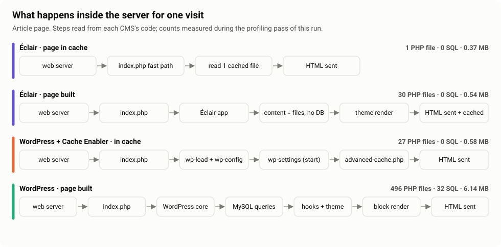

# Why Éclair is fast: the request path, explained

The benchmark shows *how much* faster Éclair is. This page explains *why*, from the code of each CMS. File names refer to the [Éclair source](https://github.com/Jacckisback/eclair-cms/tree/main/eclair) and to WordPress core.

## 1. Éclair: the page cache is checked before the application exists

Éclair's `index.php` starts with a self-contained function, the **fast path**, that runs before any other file is loaded:

1. Only `GET` and `HEAD` requests qualify.
2. It reads `cache/runtime.php`, a few bytes of JSON written by the application: is the cache on, which host and protocol are expected, when does it expire (next scheduled post), and the current **cache generation**.
3. It refuses query strings, except marketing parameters (`utm_*`, `gclid`, `fbclid`…), so `/page?utm_source=x` is still served from cache.
4. It opens `cache/pages/<md5(path)>`. The first line is a small JSON header (HTTP headers, ETag, generation); the rest is the HTML.
5. If the page's generation matches the current one, it sends the stored headers, an `ETag` (answers `304 Not Modified` when the browser already has it) and streams the body with `fpassthru()`. Then `exit`.

Result, measured: **1 PHP file, no class loaded, no configuration parsed, no database, about 0.4 MB of memory.**

**Invalidation is atomic.** Every write (a post saved, a setting changed) publishes a new random generation in `runtime.php` *before* deleting the cached pages. A page rendered from data read before the change keeps the old generation, so the fast path never serves it. There is no TTL guessing and no stale page after an edit. Scheduled posts set an expiry time in `runtime.php`, so the cache refreshes itself when a post goes live.

## 2. Éclair without cache: flat files and a small application

When the page is not cached (first visit after an edit, or a page that cannot be cached), `index.php` loads `app/bootstrap.php`:

- **About 30 PHP files**: an autoloader that loads only the classes the request needs (`Content`, `Settings`, `Site`, `Theme`…). No framework, no Composer dependency.
- **No database.** Content lives in JSON files under `data/` (each guarded by `<?php exit; ?>` so it can never be served). A compact index lists every item with what lists and menus need (title, date, excerpt, category); a full item is read only for the page being displayed.
- The theme renders plain PHP templates, the HTML is sent, then saved to `cache/pages/` for the next visitor.

Result, measured: **about 30 PHP files, 0 SQL queries, about 0.55 MB, about 3 to 4 ms** with 20 articles.

**The cost grows with the size of the site.** The index of all contents is read whole by every uncached request. With 1,000 articles a page is built in about 7 to 10 ms, with 2,900 articles in 20 to 31 ms and about 12 MB of memory (see the [site-size results](../results/large-sites/)). At 2,900 articles it is still about 2 to 3.5 times faster than WordPress, but the gap is closing, while WordPress, which queries an indexed database, stays flat at about 60 to 75 ms. Pages served from the cache are not affected (one file, under 1.5 ms, at every size). Éclair 2.x also caps a site at 3,000 contents.

## 3. WordPress + a page cache plugin (Cache Enabler)

With `WP_CACHE` on, WordPress loads the `advanced-cache.php` drop-in early, but not first:

`index.php` → `wp-blog-header.php` → `wp-load.php` → `wp-config.php` → `wp-settings.php` (constants, error handling, core loader functions…) → `wp-content/advanced-cache.php` → Cache Enabler engine → cached HTML sent.

Result, measured: **about 27 PHP files, 0 SQL queries, about 0.6 MB.** Fast, but it pays the WordPress boot sequence on every request: that is the 2× gap with Éclair on cached pages.

## 4. WordPress without cache

The full WordPress load: core (`wp-includes`, about 500 files with OPcache), options autoloaded from MySQL, the main query, the template hierarchy, the block theme (Twenty Twenty-Five parses and renders its block templates), hooks and filters.

Result, measured: **about 500 PHP files, about 30 SQL queries, about 6 MB of memory, about 60 ms.**

## What this means in practice

| Situation | What visitors get on Éclair | On WordPress |
|---|---|---|
| A normal page view | 1 PHP file, no database | 27 files with a cache plugin, 500 files and ~30 SQL queries without |
| First view after an edit | ~30 files, no database, ~3–4 ms (20 articles) to ~30 ms (2,900 articles) | ~500 files, ~30 SQL queries, ~60–75 ms at any size |
| A traffic spike | ~2× the throughput of WordPress + cache on the same server | — |
| Hosting | No database server to run, back up or secure; 2.5 MB of code | MySQL/MariaDB required; ~150 MB of code |

The exact numbers of each run are in [`results/`](../results/).
